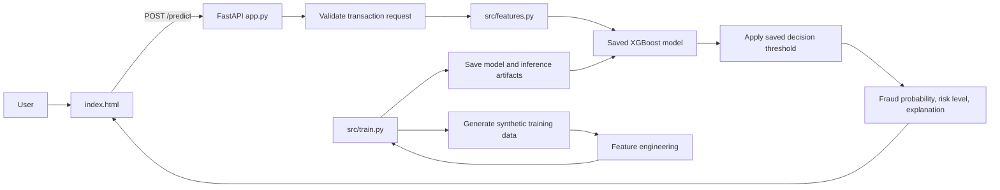

# AI-Driven Financial Fraud Detection System

[](https://github.com/ritthik7877/Ai-project)

This project demonstrates financial transaction fraud scoring with an XGBoost model. A FastAPI backend accepts a transaction, engineers model features, and returns a fraud probability, risk level, and rule-based explanation. A static HTML page provides the user interface.

- **Repository:** [ritthik7877/Ai-project](https://github.com/ritthik7877/Ai-project)
- **GitHub Pages:** [https://ritthik7877.github.io/Ai-project/](https://ritthik7877.github.io/Ai-project/)
- **Architecture and workflows:** [SYSTEM_ARCHITECTURE.md](SYSTEM_ARCHITECTURE.md)

## System Workflow



## Repository Layout

```text
Ai-project/
├── .github/
│   └── workflows/
│       └── static.yml           # Deploys the repository to GitHub Pages
├── app.py                       # FastAPI prediction API
├── index.html                   # Static browser frontend
├── src/
│   ├── features.py              # Feature engineering used for training and inference
│   └── train.py                 # Synthetic-data training and artifact export
├── models/
│   ├── fraud_xgb.json           # Trained XGBoost model
│   ├── feature_columns.pkl      # Training-time input feature order
│   └── threshold.pkl            # Fraud classification threshold
└── README.md
```

## How It Works

1. `src/train.py` generates a synthetic transaction dataset and labels fraud-like activity using account-balance, destination, amount, and transaction-velocity signals.
2. `src/features.py` derives balance consistency, drained-balance, amount, time, velocity, and transaction-type features.
3. The training script fits an XGBoost classifier, evaluates it, selects a threshold near the 95% recall target, and writes the model and inference artifacts to `models/`.
4. `app.py` loads those artifacts when the API starts.
5. The frontend submits transaction fields to `POST /predict`.
6. The API engineers the same features used during training, aligns columns to the saved schema, scores the transaction, applies the saved threshold, and returns the result.

The API also exposes `GET /health` for a basic health check.

## Requirements

Use Python 3.10 or later. Install the dependencies from the repository root:

```bash
python -m venv .venv
```

Activate the environment, then install:

```bash
# Windows PowerShell
.venv\Scripts\Activate.ps1

# macOS/Linux
source .venv/bin/activate

python -m pip install fastapi uvicorn xgboost scikit-learn pandas numpy joblib
```

## Run Locally

Start the API from the repository root:

```bash
python -m uvicorn app:app --reload --host 127.0.0.1 --port 8000
```

Check that it is available at [http://127.0.0.1:8000/health](http://127.0.0.1:8000/health). Then open `index.html` in a browser. The page currently sends requests to `http://127.0.0.1:8000/predict`, so the API must remain running on the same computer.

The prediction endpoint accepts JSON with these fields:

```json
{
  "amount": 99999,
  "hoursSinceLastTransaction": 0.2,
  "transactionsLast24h": 45,
  "isNewDestination": true,
  "hourOfDayInput": 3,
  "oldbalanceOrg": 100000,
  "newbalanceOrig": 1,
  "oldbalanceDest": 0,
  "newbalanceDest": 99999,
  "type": "TRANSFER"
}
```

`POST /predict` returns `isFraud`, `fraudProbability`, `riskLevel`, and `analysisSummary`.

## Train the Model

From the repository root:

```bash
python src/train.py
```

This uses generated synthetic data; it does not read a CSV dataset. It overwrites the three files in `models/`. The inference API requires those files to be present.

## GitHub Pages Workflow

The GitHub Actions workflow in `.github/workflows/static.yml` deploys the repository contents to GitHub Pages when a commit is pushed to `main`; it can also be started manually from the Actions tab. This publishes the static frontend, not the FastAPI service.

**Hosted-page limitation:** `index.html` currently targets `http://127.0.0.1:8000/predict`. Therefore, the published page only works for a user who has the API running locally on their own computer. To make the hosted page available to everyone, deploy the API separately and change the frontend API URL to that public HTTPS endpoint. Do not expose a development server directly to the internet.

## Notes and Limitations

- The training data is randomly generated and uses synthetic labeling rules, not a real-world fraud dataset.
- Reported metrics from this synthetic task are not evidence of production performance.
- The API's `analysisSummary` is generated by hand-written rules; it does not call an LLM.
- The current API enables permissive CORS. Restrict allowed origins before deploying the API publicly.
- The saved Python pickle artifacts should only be loaded from a trusted source.

## Contributing

Changes pushed to `main` trigger the Pages deployment workflow. For local checks, start the API and verify `/health`, then submit a sample request to `/predict` and confirm the frontend displays the response.
