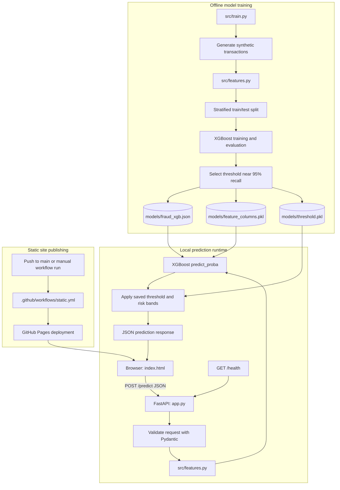
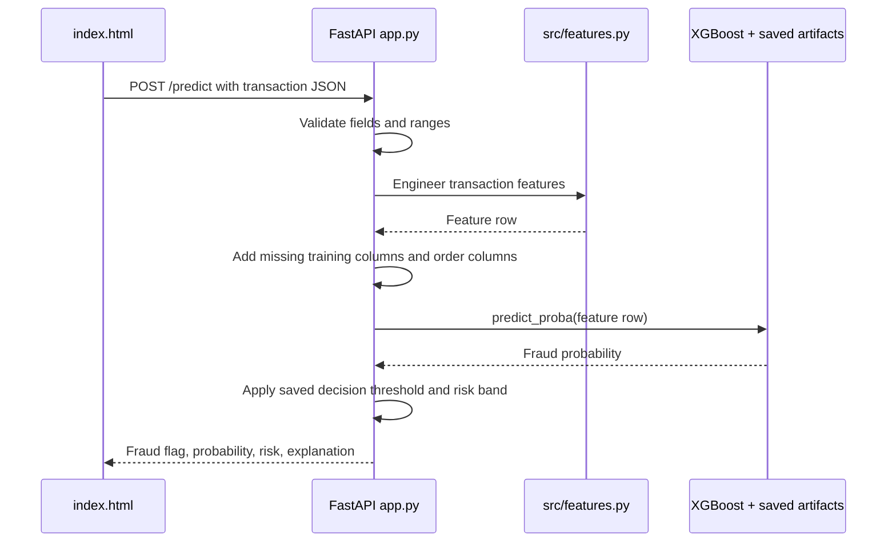

# System Architecture

Project: [ritthik7877/Ai-project](https://github.com/ritthik7877/Ai-project)  
Hosted static frontend: [ritthik7877.github.io/Ai-project](https://ritthik7877.github.io/Ai-project/)

## Architecture

## Components

| Component | Role |
|---|---|
| `src/train.py` | Creates synthetic examples, trains and evaluates XGBoost, chooses a probability threshold, and saves artifacts |
| `src/features.py` | Converts transaction input columns into the engineered feature representation expected by the model |
| `app.py` | Loads model artifacts at startup and serves health and prediction endpoints |
| `index.html` | Static browser form that posts transaction details and renders the prediction |
| `models/fraud_xgb.json` | Serialized XGBoost classifier |
| `models/feature_columns.pkl` | Ordered model feature names used to align prediction inputs |
| `models/threshold.pkl` | Threshold used to convert fraud probability into a fraud/legitimate decision |
| `.github/workflows/static.yml` | Publishes static repository content to GitHub Pages on pushes to `main`, or on manual dispatch |

## Training Workflow

1. `src/train.py` generates 10,000 synthetic transaction examples with fields for amount, balances, transaction type, time since the previous transaction, transaction count, and whether the destination is new.
2. Synthetic fraud labels are generated from configured balance-drain, new-destination, high-velocity, and short-interval patterns, with random label flips to add noise.
3. `engineer_features()` in `src/features.py` derives:
   - Absolute origin and destination balance inconsistencies
   - Drained-balance and amount-to-origin-balance ratios
   - Hour-of-day and night-time flags
   - Transaction velocity and burst indicators
   - Large-amount and log-amount values
   - One-hot encoded transaction type
4. The feature data is divided into stratified training and test sets.
5. XGBoost is trained with positive-class weighting to account for the class distribution.
6. Test probabilities are evaluated. The threshold is chosen from the precision-recall curve near a 95% recall target.
7. The model, feature order, and threshold are written to `models/`.

The training examples are synthetic; their metrics should not be interpreted as expected real-world accuracy.

## Prediction Workflow

The request model requires `amount`, `hoursSinceLastTransaction`, `transactionsLast24h`, `isNewDestination`, `hourOfDayInput`, the four before/after balance values, and `type`. Pydantic also constrains time-since-last-transaction and transaction count to non-negative values, and hour to 0–23.

The response contains:

- `isFraud`: threshold-based boolean classification
- `fraudProbability`: percentage probability rounded to two decimals
- `riskLevel`: risk band derived from probability
- `analysisSummary`: rule-based text based on transaction attributes and model output

## Hosting and Network Boundaries

The GitHub Pages workflow deploys static files only. It does not run the FastAPI backend or host the model inference service. The frontend's API URL is currently `http://127.0.0.1:8000/predict`, which points to the browser user's own machine. As a result:

- Local end-to-end use requires starting FastAPI locally and opening `index.html`.
- The published Pages frontend cannot reach a developer's local API.
- Public end-to-end use requires deploying the API separately, configuring the frontend to use its HTTPS URL, and restricting CORS to the hosted site.

There is no database, transaction persistence, authentication, or deployed model registry in the current architecture.

## Artifact and Feature Contract

Training and inference must use the same `engineer_features()` implementation and preserve the feature names and order stored in `feature_columns.pkl`. At inference, `app.py` fills absent one-hot columns with zero before selecting the saved order.

`app.py` loads `fraud_xgb.json`, `feature_columns.pkl`, and `threshold.pkl` during application startup. If any artifact is absent or incompatible, the API will fail to initialize; retrain the model to regenerate the set.
